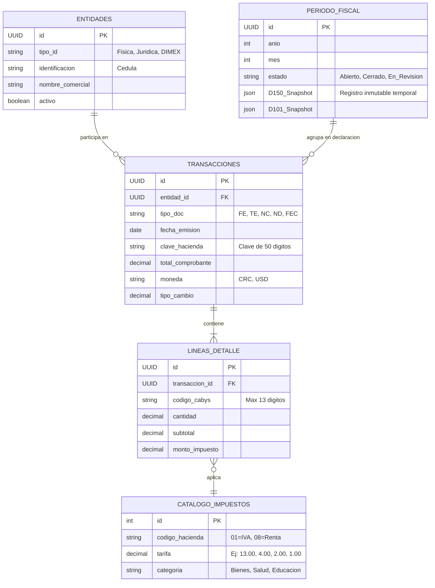

# 🇨🇷 Arquitectura y Diseño Sistema Tributario TRIBU-CR

Este documento consolida la arquitectura lógica, el modelo de datos, la experiencia de usuario y el diseño para construir un SaaS contable adaptado a las normativas de la Dirección General de Tributación de Costa Rica.

---

## 1. Investigación Tributaria: Mapeo de Declaraciones Vigentes

En el ecosistema costarricense, cualquier sistema inteligente (como FACTURAMI) debe contemplar el catálogo unificado de declaraciones (ahora perfilándose en el entorno TRIBU-CR).

### Declaraciones Autoliquidativas (Pago de Impuestos)

| Formulario | Nombre de Declaración | Sujetos Obligados | Periodicidad | Detalle Técnico y Modelo de Datos Requerido | Relaciones |
| :--- | :--- | :--- | :--- | :--- | :--- |
| **D-150** | Impuesto al Valor Agregado (Ex D-104) | Todos los contribuyentes con actividades lucrativas (excepto Régimen Especial Agropecuario) | Mensual (Primeros 15 días) | **Base:** Ventas desglosadas por tarifa (1%, 2%, 4%, 13%, Exentas).<br>**Créditos:** Compras con crédito fiscal (por tarifa).<br>**Fuentes:** Factura Electrónica (XML). | Base para los ingresos brutos en la declaración anual (D-101). |
| **D-101** | Impuesto sobre la Renta (Utilidades) | Personas Físicas / Jurídicas con actividades lucrativas no sujetas a rentas de capital exclusivamente | Anual (Cierre a dic, se presenta al 15 de marzo) | **Base:** Ingresos Brutos Netos.<br>**Deducciones:** Costos, gastos deducibles, salarios con CCSS, depreciación.<br>**Fuentes:** Saldos Contables / Cierre de Estado de Resultados. | Los ingresos totales del año deben coincidir lógicamente con la sumatoria de los 12 D-150 anuales. |
| **D-116** | Rentas de Capital Inmobiliario | Arrendadores (alquileres) con menos de 1 empleado inscrito en CCSS | Mensual | **Base:** Ingresos por alquileres.<br>**Estructura:** Deducción única del 15% (85% base neta) o deducción real.<br>**Fuentes:** Facturas de alquiler emitidas. | Excluye al sujeto del D-101 si esta es su única actividad. |
| **D-117** | Rentas de Capital Mobiliario | Perceptores de dividendos, intereses transadas, regalías | Mensual, según devengo | **Base:** Gross-up de distribución de dividendos / ganancias financieras.<br>**Fuentes:** Actas de accionistas, certificados inversiones. | Sujeto a retenciones en la fuente. |

### Declaraciones Informativas (Sin pago, sólo reporte cruzado)

| Formulario | Nombre de Declaración | Sujetos Obligados | Periodicidad | Detalle Técnico y Modelo de Datos Requerido | Relaciones |
| :--- | :--- | :--- | :--- | :--- | :--- |
| **D-151** | Resumen de Clientes, Proveedores y Gastos Específicos | Sujetos pasivos de Renta. Ojo: Se exceptúan las transacciones sustentadas en Facturación Electrónica | Anual (28 de Febrero) | **Base:** Compras/Ventas iguales o superiores a ₡2.5M que no tengan XML (Ej. entes no obligados, importaciones). Acumulado por cédula. | Cruza validaciones contra los gastos declarados en el D-101. |
| **D-152** | Retenciones en la Fuente | Patrones y entidades que hacen retenciones de ISR | Anual (Febrero) | **Base:** Salarios reportados, honorarios con retención 2%. | Cruza con lo retenido que se reporta mes a mes. |


> [!IMPORTANT]
> **El Eje del Sistema**: El 95% de la carga declarativa en Costa Rica proviene hoy del procesamiento automático de **Archivos XML (Versión 4.3)** exigidos por Hacienda. Ninguna plataforma moderna requiere digitación manual de comprobantes; todo emana del receptor de facturación.

---

## 2. Modelo de Datos Unificado (Arquitectura de Tablas)

A diferencia de los sistemas legacy que obligan a guardar "una declaración", nuestra arquitectura se basa en **eventos inmutables**. Las declaraciones son simplemente "vistas proyectadas" de transacciones.



**Ventaja de Normalización:** Si se emite una Factura Electrónica (FE), automáticamente:
1. Alimenta las cuentas por cobrar / contabilidad local.
2. Suma al "Ventas Grabadas al 13%" de la `D-150` del mes en curso.
3. Se totaliza en los Ingresos Brutos para la Renta `D-101` a fin de año.
4. Identifica si el cliente supera los márgenes de acumulación (Auditoría `D-151`).

---

## 3. Matriz de Mapeo Transaccional a Declarativo

¿Cómo un solo XML recibido afecta el SaaS?

| Etapa del Ciclo de Vida del XML (Compra) | Impacto en D-150 (Mensual) | Impacto en D-101 (Anual) |
| :--- | :--- | :--- |
| **Gastos Comerciales con IVA 13%** (Cabys de materia prima) | Genera **Crédito Fiscal Peno** (Se resta ₡X al IVA a pagar). | Entra 100% como **Gasto Deducible** bajando la utilidad del año. |
| **Compras en el exterior** (Aduanas - DUA / Servicios Digitales) | Se mapea en casilla especial de importaciones / pago de IVA. | El valor FOB/CIF cuenta como **Compra local/importada** en el D-101. |
| **Gasto Personal / No Deducible** (Supermercado / Ropa) | **NO se toma**. El contador o cliente lo marca como "Rechazar fiscalmente". | Al rechazarse, no deduce la Renta Neta. Previene contingencias con DGT. |
| **Gasto 4% (Boletos M. Salud / Educación)** | Crédito fiscal aplica proporcional o directo, o entra a la **Prorrata de IVA**. | Gasto deducible 100% en D-101. |

---

## 4. Manual de Usuario Híbrido: Cliente vs. Contable

Para tener éxito, las interfaces SaaS separan radicalmente la experiencia por roles.

### A. Para el Empresario / Cliente (Cero vocabulario complejo)
**Objetivo:** Eliminar el estrés, facilitar recolección de base imponible.

1. **Sincronización:** Entra a `FACTURAMI`. Su dashboard dice _"Buscando ventas en Hacienda..."_ (El sistema descarga los XML de manera pasiva).
2. **Revisión de Gastos (Swipe-a-Gasto):** Pantalla donde caen las facturas electrónicas de sus compras. Usamos un formato tipo tarjeta:
   * "Uber Tech: ₡4,500. ¿Fue por el negocio?"
   * 👉 **Botón Verde: Sí (Aplica)**
   * 👈 **Botón Rojo: No (Personal)**
3. **El número mágico:** En el Dashboard aparece directo: **"Reserva de impuestos de este mes: ₡140,500"**. No le hablamos de "Casilla 42", le damos certidumbre financiera.

### B. Para el CPA / Contador (Poder y Control Total)
**Objetivo:** Velocidad, Auditoría, Cero errores, Cumplimiento estricto.

1. **Validación:** Entra a la pre-liquidación D-150. El sistema detecta anomalías.
2. **Tablero de Control (Ag-Grid):** Visualización densa en tablas con atajos de teclado. Filtros como `is:rejected`, `tax:4%`.
3. **Ajustes:** Habilita botón "Asiento de Prorrata" o "Regla Automática para Proveedor X" (ej. "Todo lo que venga de Gasolinera X, aplicarle 50% de deducibilidad").
4. **Exportar a Hacienda:** Presentar mediante un Click (si implementamos API DGT) o bajando el formato nativo `.json`/`.txt`.

---

## 5. Diseño de Interfaz (UX/UI) para Formularios

Siguiendo las directrices de diseño premium, sin usar frameworks externos estandarizados, sino construyendo CSS modular y moderno (Glasmorphism, tipografías Outfit / Playfair).

### Mockup Estructural: Módulo D-150 (Liquidación IVA)

**Colores de la Vista:** `Cream` de fondo, tarjetas en `White (Opacidad 80% + Blur)`, acentos en `Ink (Negro Profundo)` e inputs minimalistas.

**1. Hero Header (Arriba)**
```html
<!-- Visualización Mental -->
[ TÍTULO EN PLAYFAIR: "Declaración Mensual IVA D-150" ]  |  [ Badge: ✨ Autocalculada ]
Periodo: DICIEMBRE 2026

[ PANEL FINANCIERO - INK BACKGROUND ]
---------------------------------------------------------
| IVA FACTURADO:             ₡ 1,500,000                |
| CRÉDITO FISCAL COMPRAS:   -₡   450,000                |
| RETENCIONES (Tarjetas):   -₡    20,000                |
|                                                       |
| TOTAL A PAGAR:             ₡ 1,030,000   [ PAGAR ]    |
---------------------------------------------------------
```

**2. Smart Accordions (Secciones sin abrumar)**
Al hacer clic, se desglosan de forma suave.

* **🔽 Ingresos (Ventas) [Revisado: 124 transacciones ok]**
  * Barras visuales: 90% Ventas al 13%, 10% Ventas exentas.
  * Botón para contador: "Ver Cédulas DGT".
* **🔽 Compras y Gastos (Adquisiciones) [⚠️ 2 Facturas por Revisar]**
  * Oculta el cálculo tributario complejo tras un dashboard limpio. Solo muestra proveedores principales que alimentan este IVA.
* **🔽 Determinación del Impuesto (Resultados Técnicos)**
  * Sólo visible o enfocado para el rol de Contador. Aquí operan los inputs de prorrata manual o saldos a favor de periodos anteriores.

---

## 6. Arquitectura Frontend (SaaS SPA)

Para una experiencia ultra-rápida (Single Page Application):

### Tecnologías:
* **HTML5 semántico** con Vanilla CSS (O variables de CSS nativas para soportar theming claro/oscuro de manera limpia).
* **JavaScript ES6+** en módulos.
* **Estado global:** Patrón Store simplificado o Context API.

### Sistema de Roles & Renderizado Condicional:

```javascript
// store.js
const appStore = {
  usuario: {
    nombre: "La Barbería CR",
    rol: "CLIENTE", // u "CONTADOR"
    regimen: "Tradicional"
  },
  declaracionActiva: {
    formulario: "D-150",
    estado: "Borrador_Inteligente"
  }
};

// taxEngine.js
function renderDashboard() {
  if (appStore.usuario.rol === 'CLIENTE') {
     mostrarWidgetResumenSimple();
     ocultarTablasDeDepreciacion();
  } else if (appStore.usuario.rol === 'CONTADOR') {
     mostrarGridContableAvanzado();
     habilitarModoEdicionManualCasillas();
  }
}
```

---

## 7. Experiencia Inteligente ("Tributín" Engine)

La diferencia entre una "calculadora" y el software diseñado aquí son las **alertas proactivas y automatización**:

1. **Auto-Cálculo Dinámico:**
   * Si cambia una categoría de una factura (de "Exento" a "Grabado al 13%"), el saldo a pagar en el dashboard parpadea y cuenta hacia arriba/abajo mediante una 'micro-animación', dando feed-back inmediato.

2. **Detección de Inconsistencias (Lógica CR):**
   > [!WARNING] Alertas del Sistema
   > "Detectamos alquiler de local (Actividad en CABYS) cobrada al 13%, pero tu negocio está inscrito bajo PYME en MEIC. **Debería cobrarte 1% de IVA.** Podría existir un error de emisión de tu proveedor."

3. **Notificaciones Push:**
   * Alerta Contable: *"El cliente ha validado todos sus gastos de este mes. El D-150 está listo para la revisión final de auditoría."*
   * Alerta Cliente: *"Recuerde que en 5 días debe pagar ₡1,030,000 en Tributación. Presione aquí para generar su archivo de pago D110."*

---

> [!TIP]
> Al separar los flujos transaccionales (facturas) de los flujos de reportería (D-150, D-101), cualquier cambio que imponga el Ministerio de Hacienda en el futuro sobre las plataformas o reglas TRIBU-CR o API integraciones será implementable sin modificar la capa de ventas y compras del cliente.
